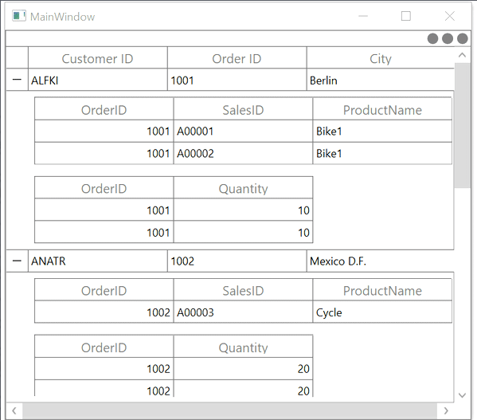
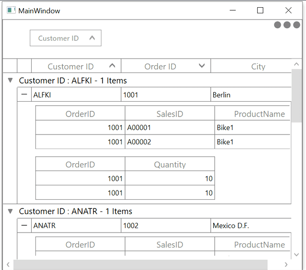

# How to Maintain the DetailsView Expanded Sstate when Sorting and Grouping the WPF DataGrid?

This sample show cases how to maintain the DetailsView expanded state when Sorting and Grouping the [WPF DataGrid](https://www.syncfusion.com/wpf-controls/datagrid) (SfDataGrid).

When you are processing the data operation ([Grouping](https://help.syncfusion.com/wpf/datagrid/grouping), [Sorting](https://help.syncfusion.com/wpf/datagrid/sorting)) the expanded DetailsViewDataGrid is collapsed in DataGrid. 

### Grouping

You can expand all the `DetailsViewDataGrid` when processing the grouping in `SfDataGrid.GroupColumnDescriptions.CollectionChanged` event. s

``` Csharp
this.dataGrid.GroupColumnDescriptions.CollectionChanged += GroupColumnDescriptions_CollectionChanged;

private void GroupColumnDescriptions_CollectionChanged(object sender, System.Collections.Specialized.NotifyCollectionChangedEventArgs e)
{
    dataGrid.Dispatcher.BeginInvoke(System.Windows.Threading.DispatcherPriority.ApplicationIdle,
        new Action(() =>
        {
            this.dataGrid.ExpandAllDetailsView();
        }));
}
```

### Sorting

You can expand all the `DetailsViewDataGrid` when processing sorting in `SfDataGrid.SortColumnsChanged` event. 

``` C#
this.dataGrid.SortColumnsChanged += DataGrid_SortColumnsChanged;

private void DataGrid_SortColumnsChanged(object sender, GridSortColumnsChangedEventArgs e)
{
    dataGrid.Dispatcher.BeginInvoke(System.Windows.Threading.DispatcherPriority.ApplicationIdle,
        new Action(() =>
        {
            this.dataGrid.ExpandAllDetailsView();
        }));
}
```
#### Before Grouping



#### After Grouping

